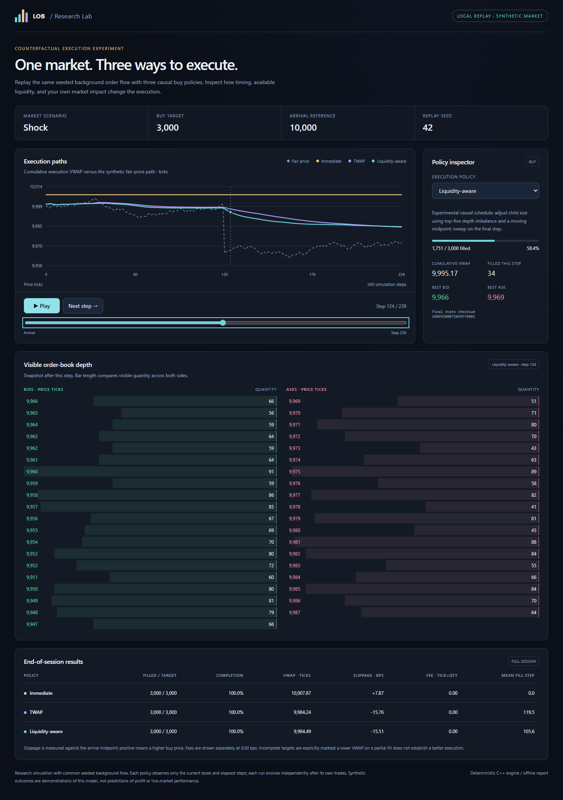

# Limit Order Book / Replay Lab

A deterministic C++20 matching engine with reproducible benchmarks and an interactive lab for exploring execution decisions in synthetic markets.

Compare immediate execution, TWAP, and a liquidity-aware heuristic against the same seeded background flow. Scrub the replay, inspect depth, and see how timing changes fills and execution costs. Open the included [example replay](examples/replay.html) locally, or generate a new experiment.

<details>
<summary>Replay preview</summary>



</details>

## Features

- Price/time priority, maker-price execution, FIFO queues, and partial fills.
- Market and limit orders; GTC, IOC, atomic FOK, and post-only behavior.
- Input validation, instrument isolation, active-ID uniqueness, and queue-preserving quantity reductions.
- Direct cancellation handles, pooled container nodes, and maintained price-level quantities.
- Caller-supplied event time, depth snapshots, invariant checks, and reproducible state/trade fingerprints.
- Optional trade retention, repeated throughput trials, separately sampled latency, and CSV exports.
- Independent-book CPU scaling with one writer per book.
- Self-contained HTML replays and multi-seed comparisons with completion, VWAP, slippage, and fees.

## Build and test

Requires a C++20 compiler and CMake 3.20 or newer. Python 3 enables additional integration tests using only its standard library; the C++ tests also run without Python. Ninja is optional.

From the repository root, on Linux, macOS, or Windows:

```sh
cmake -S . -B build -DCMAKE_BUILD_TYPE=Release
cmake --build build --config Release --parallel
ctest --test-dir build -C Release --output-on-failure
```

On Linux/macOS and Windows single-configuration builds such as Ninja, the executable is directly inside `build`. Visual Studio and other multi-configuration generators place it in `build/Release`; `--config Release` selects that configuration. For Visual Studio, use a developer shell with the C++ build tools installed.

Linux/macOS:

```sh
./build/limit_order_book simulate --scenario shock --seed 42 --output reports/replay.html
```

Windows PowerShell, with a Visual Studio generator:

```powershell
.\build\Release\limit_order_book.exe simulate --scenario shock --seed 42 --output reports/replay.html
```

For Windows Ninja/MinGW, use `.\build\limit_order_book.exe` instead. The Windows helper `Open-Lab.cmd` builds and opens a replay using portable CPU settings by default. The PowerShell helper accepts `-Native` for measurements optimized for the compiling machine. Generated reports are local outputs; a fresh checkout does not include the development `reports/` directory.

Open `reports/replay.html` in a browser after generation. Its matching JSON sidecar contains the exported replay data. No server, API key, external JavaScript, or market-data download is required. Rerunning a command overwrites its selected output. The report template is embedded in the executable at build time; runtime report generation does not require the template file or a particular working directory. Compiler runtime libraries must still be available.

## Explore

These examples use Linux/macOS executable paths; substitute the Windows path above when needed.

```sh
./build/limit_order_book --help
./build/limit_order_book benchmark --orders 1000000 --repeats 5 --output reports/benchmark.csv
./build/limit_order_book scale --orders 500000 --workers 8 --output reports/scaling.csv
./build/limit_order_book simulate --scenario rally --fee-bps 2 --output reports/rally.html
./build/limit_order_book experiment --scenario calm --seeds 30 --output reports/experiment.csv
```

The simulator supplies three controlled scenarios: a random walk (`calm`), an upward drift (`rally`), and a falling-price liquidity shock (`shock`). Policies observe current and past book state. Their own executions affect their independent books; they receive a common exogenous event tape.

The liquidity-aware policy is an experimental heuristic, not a claim of a new algorithm or a trading edge. It can perform worse than immediate execution. Partial targets remain visible and must be considered before comparing VWAP. See [simulator assumptions and results](docs/simulator.md).

## Architecture

`OrderBook.h` maintains separate ordered bid/ask maps. Each price level holds a FIFO list; a hash index stores order and level iterators for direct cancellation. Pooled map/list/hash nodes reuse memory, while aggregated level quantities support snapshots and FOK preflight checks.

Cancellation is expected/amortized O(1); creating a price level requires O(log L) tree work. Pools can grow and allocate. Each book has a single writer; the scaling experiment runs separate books across workers.

`Benchmark.cpp` measures the engine, `ReplayLab.cpp` generates scenarios and policy comparisons, and `assets/replay.html` renders exported data. Prices and quantities use integer ticks/lots. Fingerprints check reproducibility and are not cryptographic hashes. Active order IDs may be reused after removal; applications needing lifetime-unique identities must enforce that convention.

## Measurements and validation

One development measurement on an AMD Ryzen 9 8945HS reported **5.361 million orders/s** for the upgraded retained-trade engine versus **4.210 million orders/s** for the preserved original, approximately 27% higher throughput. This is a workload-specific comparison with different timestamping and bookkeeping behavior. Eight independent books reached **35.550 million aggregate orders/s** in a separate scaling run. Methodology, environment, raw CSV evidence, and limitations are in [benchmarking notes](docs/benchmarking.md).

C++ checks remain active in Release builds. Tests cover matching, validation without mutation, order modifiers, cancellation, reductions, snapshots, determinism, quantity limits, and instrument isolation. A vector-scan reference model checks 12,000 randomized events across three seeds, including fills, order state, depth, and conservation.

Optional Python integration tests check replay exports, deterministic repeats, scenario paths, execution accounting, fees, incomplete targets, experiment pairing, and CLI validation. Browser checks exercise playback, policy selection, keyboard controls, and responsive rendering.

This is an educational research engine. It has no durable recovery, risk gateway, self-trade prevention, authentication, networking, session protocol, or transactional recovery from allocation failures. See the detailed [engine and measurement boundaries](docs/benchmarking.md#boundaries).

## Attribution and licensing

Original source headers credit **Oscar Zhang**. The original downloaded files are retained in [`original/`](original/) for attribution and local comparisons. The supplied archive contained no Git history, upstream repository URL, or license file. See [source attribution](docs/ATTRIBUTION.md).

No project-wide license is declared because the supplied snapshot did not include one. This repository extends the supplied project and retains the original author credits.

For repository preparation and GitHub upload commands, see [publishing instructions](docs/PUBLISHING.md). See [contribution guidelines](CONTRIBUTING.md) for development checks.
